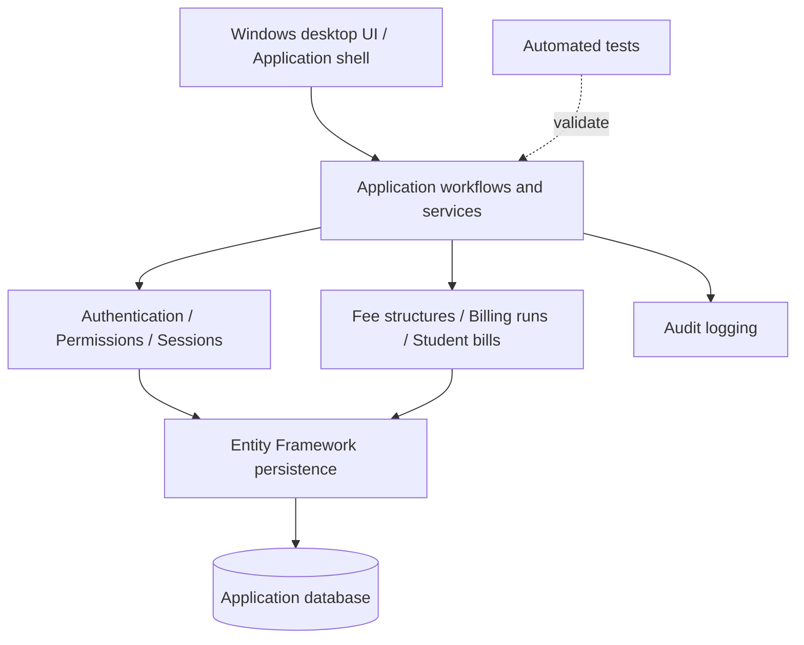

# NetSchool Plus — Enterprise ERP Engineering Case Study

**C# · .NET · Entity Framework · Dependency Injection · Role-Based Access Control · Automated Testing**

> **Status: In development.** This repository documents engineering decisions and implementation milestones. It is **not** the application's production source repository, a downloadable product, or evidence of a live deployment.

## Overview

NetSchool Plus is a modular Windows desktop ERP application designed around school administration and finance workflows. The engineering focus is on making business rules testable, establishing authorization and audit boundaries, and preventing accidental duplicate billing.

**My contribution:** Application architecture, C#/.NET implementation, database and financial workflow design, security architecture, and testing as part of development at Net IT Solutions (Pvt) Ltd.

## What has been implemented or reported

The following are development milestones, **not claims of production readiness**:

- Dependency-injection-based application composition and modular separation of concerns.
- User accounts, roles, permissions, sessions, and auditing foundations.
- Login and forced password-change workflow.
- Licensing gate, school profile, and active academic year/term configuration.
- Application shell/navigation and an initial dashboard.
- Finance domain entities: `FeeStructure`, `FeeStructureItem`, `BillingRun`, `StudentBill`, `StudentBillLine`, and `FeeDiscountExemption`.
- A billing-source identity (`BillingSourceKey`) intended to support idempotent billing runs.
- **68 passing automated tests** at a recorded development milestone. This is a historical project milestone, not a current live CI result.

## Engineering approach

| Concern | Design approach |
| --- | --- |
| Maintainability | Dependency injection and modular application composition |
| Access control | User identities, roles, permissions, and session handling |
| Traceability | Audit-oriented security and workflow design |
| Financial integrity | Source-key-based idempotency and carefully modeled billing entities |
| Quality | Automated tests covering application behavior during development |

## Architecture

The diagram below is a **conceptual representation** of the reported architecture, not a claim that every component is a separate deployed service.

For more details, see [Architecture](docs/ARCHITECTURE.md), [Billing and data integrity](docs/BILLING-INTEGRITY.md), and [Testing](docs/TESTING.md).

## Interface visuals

No actual application screenshots are published in this repository. Any concept mockups shared separately must be explicitly labelled **illustrative—not actual captures**. This avoids suggesting unverified interface or module completion.

## Roadmap (planned, not yet verified as implemented)

Potential areas for future development include admissions, student records, payroll, library, assessments, communications and reporting. Roadmap entries should not be interpreted as completed features.

## Public portfolio vs. proprietary source

This repository is intended to explain engineering work. Commercial implementation details, deployment credentials, client records, internal configuration and proprietary source remain private. No sensitive information or customer data should be committed here.

## Author

**Justice Zhou** — Software Engineer and Founder, Net IT Solutions (Pvt) Ltd  
[GitHub](https://github.com/JUZHOU88) · [Company GitHub](https://github.com/NETITSOLUTIONS)

---

*This case study reflects reported development milestones and is updated as evidence and public-safe materials become available.*
